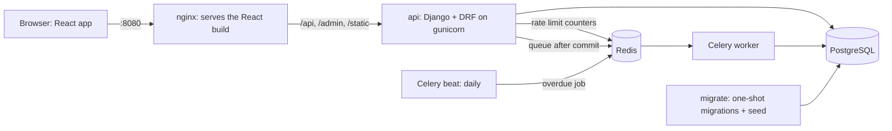
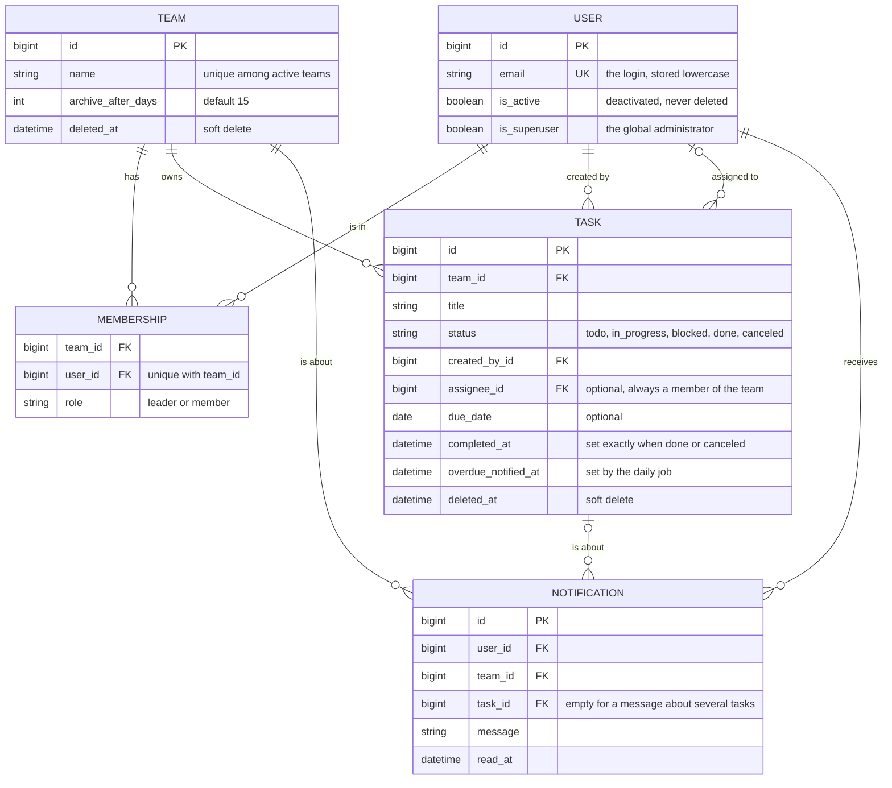

# Task manager

A task management system for teams: a Django REST API, a React frontend, and background jobs for notifications.
Users belong to teams as leaders or members, create and assign tasks on a team board, move them through their
statuses, and are notified when a task is assigned to them or becomes overdue. Administrators manage users and
teams in the Django admin site.

- How the project was built with a GenAI tool, and how its output was checked: [`GENAI.md`](GENAI.md).
- Requirements: [`docs/requirements.md`](docs/requirements.md). The full specification and build plan:
  [`docs/implementation-prompt.md`](docs/implementation-prompt.md). Ideas for later: [`docs/backlog.md`](docs/backlog.md).

# Part 1: Setup and instructions

## Prerequisites

- Docker with Docker Compose v2 (`docker compose`).
- Nothing else for running the app. For working on the code outside Docker: Python 3.12+ with
  [uv](https://docs.astral.sh/uv/), and Node.js 24.

Verified on Linux (WSL2 on Windows, Docker Engine). `run.ps1` (Windows PowerShell) mirrors `run.sh` but has not been
tested.

## Run

```sh
./run.sh            # or: ./run.sh up       (Windows: .\run.ps1)
```

On the first start it copies `.env.example` to `.env`. Then it builds the images and starts everything:
PostgreSQL, Redis, a one-shot `migrate` service that applies the migrations and loads the demo data (safe to run
again), the API (gunicorn), the Celery worker and beat, and nginx serving the frontend. When every service is
healthy it prints the URLs.

```sh
./run.sh down       # stop (the database volume is kept)
./run.sh test       # backend tests with coverage, inside the api container
```

Without the wrappers: `cp .env.example .env`, then `docker compose up --build -d --wait`.

## URLs

Everything goes through nginx on one port (`FRONTEND_PORT`, default 8080). The API container is not published on
the host on purpose (see "Rate limiting" in Part 2).

| What | URL |
|---|---|
| Web app | http://localhost:8080/ |
| API | http://localhost:8080/api/v1/ |
| Swagger UI / OpenAPI schema | http://localhost:8080/api/v1/docs / http://localhost:8080/api/v1/schema |
| Django admin site | http://localhost:8080/admin/ |
| Health check | http://localhost:8080/api/v1/health |

## Demo credentials (demo only)

The seed creates these accounts. **The password is public and for local demo use only.** All accounts share it:
`Demo-only-pass-2026`.

| Account | Role |
|---|---|
| `admin@example.com` | Administrator: sees every team, uses the Django admin site |
| `ana@example.com` | Leader of Platform, member of Mobile App |
| `carla@example.com` | Leader of Mobile App, member of Platform |
| `bruno@example.com` | Member of Platform, leader of Legacy Migration (a deleted team) |
| `diego@example.com`, `fabio@example.com` | Members |
| `eva@example.com`, `gabi@example.com` | Members of Design Guild, a team with no leader |

The tasks cover every status, overdue tasks, unassigned tasks, and finished tasks old enough to be archived.

## Connect to PostgreSQL (DBeaver or any client)

PostgreSQL is published on the host. Use the values from `.env`:

| Setting | Value (defaults from `.env.example`) |
|---|---|
| Host | `localhost` |
| Port | `POSTGRES_PORT` (5432) |
| Database | `POSTGRES_DB` (`taskmanager`) |
| User | `POSTGRES_USER` (`taskmanager`) |
| Password | `POSTGRES_PASSWORD` (`demo-only-password`) |

## Restore a deleted team or task

Deleting a team or a task never removes the row: it sets `deleted_at` and `deleted_by`, and every query in the
app leaves those rows out. There is no restore screen or endpoint; restoring is a database query:

```sql
-- A team, here the seeded deleted one (its memberships and tasks were never touched, so they come back with it).
-- Fails with a unique violation if an active team has taken the name meanwhile: rename one first.
UPDATE teams_team SET deleted_at = NULL, deleted_by_id = NULL
WHERE name = 'Legacy Migration' AND deleted_at IS NOT NULL;

-- A task.
UPDATE tasks_task SET deleted_at = NULL, deleted_by_id = NULL WHERE id = 42;
```

To find them: `SELECT id, name, deleted_at FROM teams_team WHERE deleted_at IS NOT NULL;` (and the same on
`tasks_task` with `title`).

## Tests and checks

```sh
./run.sh test                                 # backend: pytest with coverage (fails below 80%)

cd backend && uv sync                         # backend outside Docker (needs the stack's PostgreSQL)
set -a; . ../.env; set +a
uv run pytest
uv run ruff check . && uv run ruff format --check . && uv run mypy .

cd frontend && npm ci                         # frontend
npm run lint && npm test && npm run build     # eslint, vitest, then tsc and the production build
```

`pre-commit install` (from the repo root) runs ruff, ruff format, mypy (strict) and file checks on each commit.
CI (`.github/workflows/ci.yml`) runs the backend and frontend checks on pushes to `main`.

## Run the overdue job on demand

Celery beat runs it daily at `OVERDUE_JOB_TIME` (default 08:00, in `TIME_ZONE`). To run it now:

```sh
docker compose exec api python manage.py notify_overdue
```

It prints how many notifications it sent. A second run sends nothing new.

## Frontend development

`docker compose` serves a production build. For hot reload, keep the stack running and start the Vite dev server,
which forwards `/api` to it:

```sh
cd frontend && npm ci && npm run dev          # http://localhost:5173
```

## Project structure

```
backend/
  config/            settings (all from environment variables), URLs, Celery app
  apps/
    core/            base model (timestamps), domain exceptions, the single API error handler, health
    accounts/        custom user (email login), JWT auth endpoints, rate limits
    teams/           teams, memberships and roles, Django admin site
    notifications/   stores and delivers notifications (knows no task rule)
    tasks/           tasks, their rules, the overdue job, the assignment notification, the demo seed
  Each app: models.py, services.py (the only write path), selectors.py (reads), policies.py (permissions),
  serializers.py and views.py (thin API layer), tests/
frontend/
  src/api/           the one HTTP client (tokens, refresh, errors) and typed endpoints
  src/features/      auth, teams, tasks, notifications: pages, components and their queries
  src/components/    shared UI pieces
  nginx.conf         serves the build, proxies /api, /admin and /static to the api
docs/                requirements, implementation prompt, GenAI journal, backlog
docker-compose.yml   the whole stack; run.sh and run.ps1 are thin wrappers around it
```

# Part 2: User story and design

## Who uses it

The requirements say tasks are assigned to users, but not who may see a task or assign it to whom. Teams with two
roles are the smallest model that answers that: people see and assign tasks inside their own teams.

- **A team member** opens the board of their team: one column per status (to do, in progress, blocked, done,
  canceled). They create tasks, take an unassigned task, move tasks through their statuses from the card, and
  filter the board by assignee, due date and overdue. When they finish a task by mistake, an Undo appears for a few
  seconds. The bell tells them when someone assigns them a task and when their tasks become overdue.
- **A team leader** does the same with more rights: edits and deletes any task of the team, adds members by email,
  promotes and demotes, removes members. Removing someone unassigns their tasks. Leaders are told every morning
  about the team's overdue tasks, one message per team rather than one per task.
- **An administrator** creates users and teams in the Django admin site, sees every team, deletes teams, and finds
  teams left without a leader with a filter. Admins are not notified about every team's overdue tasks.

Users are created by administrators; there is no sign-up.

## Requirements coverage

| Requirement | Where |
|---|---|
| Task CRUD, assign, mark completed | `apps/tasks`: `/api/v1/tasks`, `.../reopen`, `.../assign-self`; the board and task dialogs |
| Filter by status and due date | `status`, `due_after`, `due_before`, plus `assignee`, `overdue`, `archived`, `team` |
| Pagination | Page number, 20 per page, `page_size` up to 100; one paginated request per board column |
| JWT authentication | SimpleJWT: 15-minute access token, rotating refresh tokens blacklisted on use and logout |
| PostgreSQL | PostgreSQL 17 in Compose; schema in each app's `models.py` |
| Tests, 80% coverage | pytest, 250 tests, 99.93% branch coverage; vitest for the frontend client |
| Docker | `backend/Dockerfile`, `frontend/Dockerfile`, `docker-compose.yml` |
| API documentation | drf-spectacular: Swagger UI and OpenAPI schema; a test fails on any undocumented endpoint |
| Configuration and good practice | uv with `pyproject.toml`, ruff, mypy in strict mode, pre-commit, GitHub Actions |
| Rate limiting | 5 logins per minute per client address, 300 requests per minute per user, counted in Redis |
| Background tasks | Celery with Redis: assignment notification after the commit, daily overdue job with beat |
| React frontend, responsive | React, TypeScript (strict), Vite, TanStack Query, Tailwind; the board scrolls by column on phones |
| Seed data and demo credentials | `manage.py seed_demo`, run by the `migrate` service; credentials above |
| GenAI documentation | [`GENAI.md`](GENAI.md), with the evidence in [`docs/genai-journal.md`](docs/genai-journal.md) |

## Architecture



Inside the API, each app has the same layers. A request goes view → serializer (input shape) → service (rules and
invariants, the only code that writes) → model. Reads go through selectors. Permission rules are plain functions in
`policies.py`, called by the services, so the API, the Django admin site and the jobs all run the same rules.
Services raise domain exceptions; one handler turns them into HTTP with one JSON shape (`{code, message, details}`).

Apps depend in one direction: `core` → `accounts` → `teams` → `notifications` → `tasks`. The one exception is
documented: removing a member (`teams`) calls one `tasks` function to unassign their tasks in the same transaction.

## Data model



Every table also has `created_at` and `updated_at`. The database itself enforces what it can: one membership per
team and user, lowercase emails, team names unique among active teams, and `completed_at` matching the status.

## Key decisions and trade-offs

The design was agreed one topic at a time before any code was written; the journal records who decided what.

- **Business rules live in services, not views or serializers.** The Django admin site would otherwise be a back
  door around them, so its forms call the same services, inlines are off and bulk delete is disabled. Cost: more
  files per app than a plain `ModelViewSet`; in return every rule is tested once, at the service.
- **Team roles in our own `Membership` table, not Django groups.** A user can lead one team and be a member of
  another; Django groups are global. The global administrator is simply `is_superuser`.
- **An assignee is always a member of the task's team.** Checked on every write, and kept true when a member
  leaves: their tasks are unassigned in the same transaction, not by a later job, so the rule is never false.
- **Done and canceled are final; only reopen leaves them** (to in progress). Simple rules over free movement.
  "Archived" is not a status but a query: finished more than `archive_after_days` (per team, default 15) ago.
- **Soft delete for teams and tasks, restored only by SQL.** Deletes are recoverable without building a restore
  feature nobody asked for. The filtering is explicit in the selectors, not hidden in a default manager.
- **Hidden things answer 404, forbidden actions 403.** A user outside a team cannot learn that its tasks exist.
- **Rate limiting.** Counted in Redis, not in process memory, because gunicorn runs several workers. The login
  limit counts per client address, which the API reads from `X-Forwarded-For` set by nginx. That header can be
  forged by any client that reaches the API directly, so the API port is not published: nginx is the only way in.
- **Notifications are polled, not pushed.** The bell asks every minute. Websockets would add a server and a
  protocol for a feature that tolerates a minute of delay. The assignment notification is queued only after the
  transaction commits; if the broker is down the change is kept and the notification is lost (logged), rather
  than failing the user's save.
- **Overdue notifications are grouped.** One message per person and team per day ("Team Y has 6 overdue tasks")
  instead of one per task, and a task is notified once. Running the job twice, or twice at the same time, sends
  nothing new.
- **Tokens in the browser.** The access token lives only in memory; the refresh token in `localStorage`, so a
  reload keeps the session. An XSS bug could read the refresh token; the damage is limited by rotation, blacklisting
  and 15-minute access tokens. An httpOnly cookie is safer but needs CSRF protection the API does not have.
- **The frontend never decides permissions.** Each task carries `can_edit` and `can_delete`, computed by the same
  policies as the API, without an extra query per task. The API still checks every action.
- **API documentation with drf-spectacular, not drf-yasg.** drf-yasg only generates OpenAPI 2 (Swagger 2.0);
  drf-spectacular generates OpenAPI 3 and serves the same Swagger UI. A test fails when an endpoint is left
  undocumented, so the documentation cannot fall behind the code.
- **Typed Python** checked by mypy in strict mode, so the layers' contracts are checked, not just documented.
- **No database index added yet.** Measured on 200k generated tasks: a member's list takes 1-5 ms without one. A
  partial index would speed up the administrator's all-teams page (90 ms to 0.3 ms) and is in the backlog until
  that page matters.

Known limits, all in the backlog: the last save wins when two people edit the same task; "Load more" pages by
number, so a task moving between columns can be skipped until the next refresh; with Redis fully down, login
fails; no change-password screen (the endpoint exists); the HTTPS settings (`check --deploy`) belong to a real
deployment behind TLS.
