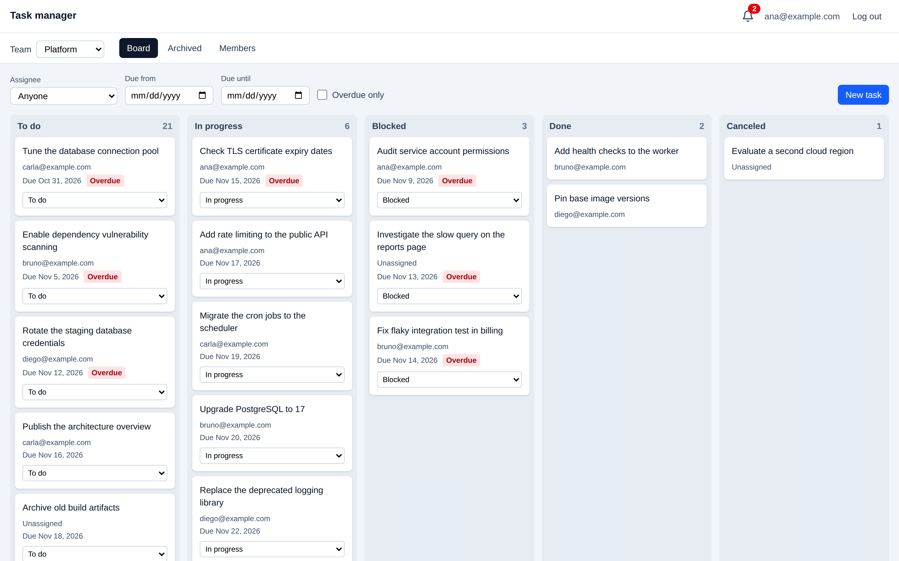

# Task manager

A task board for teams. Each team has a board; members create tasks, take them and move them from "to do" to
"done"; leaders manage the team; everyone is told when a task is assigned to them or runs late.



Under it: a Django REST API, a React frontend and a Celery worker, started with one command. It was built with a
GenAI coding tool (Claude Code); [`GENAI.md`](GENAI.md) describes the process and how the output was checked.

Part 1 is how to run it. Part 2 is the reasoning: the use case, the choices, what each one cost, and what is
still missing. With five minutes, read [The use case](#the-use-case), [Strengths and gaps](#strengths-and-gaps)
and the "In short" of [`GENAI.md`](GENAI.md).

# Part 1: Setup and instructions

## Prerequisites

- Docker with Docker Compose v2 (`docker compose`). Nothing else is needed to run the app.
- Only for working on the code outside Docker: Python 3.12+ with [uv](https://docs.astral.sh/uv/), and Node.js 24.

## Usage

```sh
./run.sh up              # build and start everything, with the demo data (the default command)
./run.sh up --no-seed    # same, without loading the demo data
./run.sh down            # stop (the database volume is kept)
./run.sh test            # backend tests with coverage
```

On Windows: `.\run.ps1 up`, `.\run.ps1 up -NoSeed`, `.\run.ps1 down`, `.\run.ps1 test` (untested).

Then open http://localhost:8080/ and log in as `ana@example.com` (a team leader) or `diego@example.com` (a
member). The password for every demo account is `Demo-only-pass-2026`: it is public and for local demo use only.
API docs: http://localhost:8080/api/v1/docs.

## Documentation

- [`docs/running.md`](docs/running.md): what the script does, URLs, database access, tests, development.
- [`seed/README.md`](seed/README.md): every demo account and the sample data.
- [`GENAI.md`](GENAI.md): how the project was built with a GenAI tool, and how its output was checked.
- [`docs/requirements.md`](docs/requirements.md), [`docs/implementation-prompt.md`](docs/implementation-prompt.md),
  [`docs/backlog.md`](docs/backlog.md).

# Part 2: User story and design

## The use case

A company has a few teams. Each team wants one place that answers three questions: what is waiting, who has
what, and what is late.

The project started from a [short list of requirements](docs/requirements.md): a task manager where tasks are
assigned to users. The list does not say who may see a task, or who may assign it to whom. Every permission
rule depends on that answer, so that question was settled first. With no boundary, every user sees every task and anyone assigns anything to anyone. Teams with two
roles are the smallest model that gives a real answer: people see and assign tasks inside their own
teams, and a leader looks after the team.

| Who | What they can do |
|---|---|
| Team member | See the team's board, create tasks, take an unassigned task, edit tasks they created or are assigned to, filter by assignee, due date and overdue, leave the team |
| Team leader | Everything a member does, on any task of the team; add members by email, promote, demote and remove them |
| Administrator | Everything, in every team; creates users and teams, deletes teams, finds teams left without a leader |

### What was left out, and why

During the design, "what if" questions kept turning into features, and the task manager was growing into a
much larger product that the requirements never asked for. That drift was stopped by a person, not by the AI
([GENAI.md](GENAI.md), section 5, has the exchange). The rule after
that: an idea that does not change the foundation goes to the [backlog](docs/backlog.md) and is not
built. Left out on purpose: quotas, custom statuses per team, status history, drag and drop on the board,
sign-up and password reset by email, and invitations.

To click through it in five minutes with the demo accounts, follow [the tour in `docs/running.md`](docs/running.md#a-five-minute-tour).

## Architecture

| Container | What it does |
|---|---|
| `frontend` (nginx) | The only open door, on port 8080. Serves the React build and forwards `/api` and `/admin` to the API |
| `api` | Django and DRF on gunicorn. Reads and writes PostgreSQL; keeps rate limit counters in Redis and queues jobs there |
| `db` | PostgreSQL 17 |
| `redis` | Rate limit counters, and the queue between the API and the worker |
| `worker` | Celery. Takes jobs from Redis and writes notifications to PostgreSQL |
| `beat` | Celery beat. Queues the overdue job once a day |
| `migrate`, `seed` | Run once at startup and exit: apply the migrations, load the demo data |

A request goes browser → nginx → API → PostgreSQL. A notification goes API → Redis → worker → PostgreSQL.

Everything enters through nginx on one port. The API container is not published on the host, so no client can
reach it directly and forge its own address (see "Security" below).

Inside the API, every app has the same layers, and a request crosses them in one direction:

| Layer | Its one job |
|---|---|
| `views.py`, `serializers.py` | HTTP only: check the shape of the input, call a service or a selector, return the result |
| `services.py` | The business rules, and the only code that writes (one exception, under "Rules and layers") |
| `selectors.py` | The read queries. "Leave out deleted rows" is written here, once |
| `policies.py` | "May this user do this?" as plain functions that return yes or no |
| `models.py` | Tables and the constraints the database can enforce |

Services raise domain errors and know nothing about HTTP. One handler turns those errors into responses, so
every error has the same JSON shape: `{code, message, details}`. Because the rules are below the views, the API,
the Django admin site and the background jobs all run the same ones.

The apps depend on each other in one direction: `core` → `accounts` → `teams` → `notifications` → `tasks`. There
is one exception, and it is deliberate: removing a member (`teams`) calls one function in `tasks` to unassign
that person's tasks in the same transaction. An explicit call was chosen over a Django signal, because a signal
hides the behaviour and a call can be read and tested.

**Is this Clean Architecture?** It follows the two principles that matter at this size: separation of concerns,
and dependencies that point one way. It is not the full pattern. Services use the Django ORM directly; there
are no repository interfaces and no domain entities separate from the models. That indirection would add
a layer of interfaces and mapping code with no second implementation behind it. The accepted cost: the rules depend on Django, and their tests need
PostgreSQL. The separation becomes worth adding if the rules have to outlive the framework.

## Data model

| Table | What it holds | Worth knowing |
|---|---|---|
| `User` | Email (the login, stored lowercase), `is_active`, `is_superuser` | Deactivated, never deleted. `is_superuser` is the global administrator |
| `Team` | Name, `archive_after_days` (default 15), `deleted_at` | The name is unique among active teams. Soft delete |
| `Membership` | Team, user, role (`leader` or `member`) | One row per team and user. This is where roles live |
| `Task` | Team, title, status, creator, assignee, due date, `completed_at`, `overdue_notified_at`, `deleted_at` | The assignee is optional and always a member of the team. `completed_at` is set exactly when the task is done or canceled. Soft delete |
| `Notification` | User, team, task, message, `read_at` | The task is empty for a message about several tasks |

A team has many memberships and many tasks. A user has many memberships, creates tasks, may be assigned tasks,
and receives notifications.

Every table also has `created_at` and `updated_at`. The database enforces what it can: one membership per team
and user, lowercase emails, team names unique among active teams, and `completed_at` matching the status. A
service rule that the database also checks cannot be skipped by a mistake in the code.

## Why this stack

| Choice | Why | What it costs |
|---|---|---|
| Django 6.0 and DRF | Auth, the ORM, migrations and the admin site come ready, so the time went to the rules. 6.0 and not 6.1 because drf-spectacular does not declare support for 6.1 yet | The rules depend on the framework (see Architecture) |
| Plain `APIView`, not `ModelViewSet` | A viewset saves code by letting the serializer write to the database. Here only services write, so that saving is not available | URLs and schema annotations written by hand |
| PostgreSQL 17 | The overdue job uses `SKIP LOCKED`, and the design leans on database constraints (team names unique among active teams). It is also what production would run | SQLite would start faster |
| SimpleJWT | The requirements ask for JWT. Short access tokens, rotating refresh tokens, a blacklist | An access token cannot be revoked: after logout it works for up to 15 minutes |
| Celery and Redis | Two real jobs: a notification after an assignment, and a daily overdue run. Redis is also the rate limit store | Three more containers (Redis, worker, beat) |
| drf-spectacular | OpenAPI 3 and Swagger UI. drf-yasg only generates Swagger 2 | Every view needs an explicit schema annotation |
| React 19, TypeScript, TanStack Query | The requirements ask for a React frontend. Server data lives in the query cache; there is no global store. A server-rendered product would use Django templates with HTMX | A second toolchain and a second language |
| nginx | Serves the frontend build and proxies the API: one origin, no CORS, one way in | One more container |
| uv, ruff, mypy (strict), pre-commit | One lock file gives the hooks, the CI and the editor the same tool versions. Strict types are a second check on generated code: a wrong argument or a misspelled model field fails mypy. It does not cover query annotations or serializer dictionaries, which are read by name | Type stubs must match the Django version exactly ([GENAI.md](GENAI.md), section 5, has the mistake) |

## Decisions and what they cost

The design was agreed one topic at a time before any code existed. [`docs/genai-journal.md`](docs/genai-journal.md)
records who decided what.

### Rules and layers

- **The Django admin site runs the same rules.** Without that it is a back door around every one of them. So
  membership changes and team deletes in the admin site call the services, inlines are off, bulk delete is
  disabled and tasks are read-only there. One limit: admins create and rename teams and users through the
  standard admin forms, where the database constraints are the only rules.
- **Services, not fat models.** A rule that touches several tables (remove a member, unassign their tasks) has
  no natural model to live in, and a function that takes the actor makes the permission check part of every
  write. Nothing in Django stops code from bypassing a service; the convention is held by review and by the
  admin site calling the same functions. Cost: more files per app than a plain `ModelViewSet`.
- **Hidden things answer 404, forbidden actions answer 403.** A user outside a team cannot learn that its tasks
  exist. A member who may see a task but not delete it gets a 403.
- **The frontend never decides permissions.** Each task carries `can_edit` and `can_delete`, computed by the
  same policies the API enforces, with no extra query per task. The API still checks every action.

### Teams and tasks

- **Roles live in a `Membership` table, not in Django groups.** Groups are global, and one person can lead
  team A and be a member of team B. The global administrator is simply `is_superuser`.
- **An assignee is a member of the task's team.** It is checked whenever a task is created or reassigned.
  When a member leaves, their tasks are unassigned in the same transaction and not by a later job, so there is
  no window with wrong data. Both sides lock the membership row, so an assignment and a removal at the same
  time cannot slip past each other.
- **Done and canceled are final; only "reopen" leaves them.** The first choice was free movement between statuses. But `completed_at` then has no clear meaning, so the
  choice was reversed. Cost: less freedom for the user.
- **"Archived" is a query, not a status.** A task is archived when it was finished more than
  `archive_after_days` ago (per team, default 15). No job, no column, nothing to get out of sync. Reopening a
  task brings it back.
- **Soft delete, restored only by SQL.** Deletes are recoverable without building a restore screen nobody asked
  for. The filter is explicit in the selectors and not hidden in a default manager, which would surprise the
  admin site and anyone reading a query.
- **A due date is a day, not a moment.** This avoids time zone questions. "Overdue" is computed by the API, so
  the frontend can never disagree. Cost: no "due at 15:00".

### Security

- **Rate limits are counted in Redis.** gunicorn runs three workers, and a count kept in process memory would
  multiply every limit by three. Login is limited per client address, which the API reads from the
  `X-Forwarded-For` header set by nginx. Any client that reaches the API directly can forge that header. That
  is why the API port is not published: nginx is the only way in. A review found this hole open
  ([GENAI.md](GENAI.md), section 5).
- **Tokens in the browser.** The access token stays in memory. The refresh token is in `localStorage`, so a
  reload keeps the session. Cost: an XSS bug could read the refresh token. Rotation, the blacklist and
  15-minute access tokens limit the damage. An httpOnly cookie would be safer, but it needs CSRF protection
  that the API does not have.
- **Adding a member by email reveals whether that email has an account.** Only to leaders, and only under the
  general limit of 300 requests per minute. Hiding it needs an invitation flow, which is in the backlog.

### Notifications and performance

- **Polling, not websockets.** The bell asks once a minute. A push channel would add a server and a protocol
  for a feature that tolerates a minute of delay.
- **A broker outage loses the notification, not the change.** The broker is Redis, the queue between the API
  and the worker. The assignment notification is queued after the task is saved. If Redis is unreachable, the save is kept and the failure is logged. The first version
  answered 500 for a change that was already saved; a review caught it.
- **Overdue notifications are grouped and sent once.** One message per person and team per run
  (`Team "Platform" has 6 overdue tasks.`), and each task is reported once. The job locks the rows it works on and skips rows another run has locked, so running it
  twice, or twice at the same moment, sends nothing new.
- **No index was added without a measurement.** On 200,000 generated tasks, a member's list takes 1 to 5 ms with
  no index. A partial index would take the administrator's all-teams page from 90 ms to 0.3 ms. It is in the
  backlog until that page matters.

## Strengths and gaps

What holds up:

- **One source of permission rules** feeds the API, the admin site and the `can_edit` and `can_delete` flags.
- **Every rule has a test**: 244 backend tests at 99.92% branch coverage, including the permission matrix,
  ex-members and other teams. The tests were written alongside the code, not test-first: a choice of working
  style, made before the build. A coverage number
  proves little alone, so [GENAI.md](GENAI.md) section 6 names the test behind each rule.
- **Tests fail when a list endpoint gains an N+1 query**, when an endpoint is not annotated for the OpenAPI schema,
  and on any warning.
- **Failure cases were tried on the running stack**: the broker down, the job run twice, a forged header,
  malformed filters.
- **One command** from a fresh clone starts everything with data to click on.

What is missing or weak. The planned fixes are in the [backlog](docs/backlog.md):

- **Two people editing the same task: the last save wins.** There is no version check. (Taking a task is
  safe: it is one conditional `UPDATE`, so when two members take the same task, one gets a 409.)
- **`tasks/services.py` does three things**: the task rules, the assignment notification and the overdue job. It
  is the first file to split.
- **A notification can be lost** when the broker is down. There is no outbox table.
- **With Redis fully down, login answers 500**, because the rate limit counts there. Allowing logins keeps the app usable and removes the brute-force
  protection during the outage; refusing with a 503 protects accounts and locks everyone out. That choice is
  not made yet.
- **"Load more" pages by number**, so a task that changes column while someone pages can be skipped until the
  next refresh. Cursor pagination fixes it.
- **The frontend has few tests**: 14, on the API client and its token refresh, the return path after login and
  one list helper. There is no browser test in the suite; the console was checked with a headless browser by
  hand (no messages on login, board, task dialog, archived and members pages).
- **Not built for production yet**: the HTTPS settings are off for the local demo, PostgreSQL is published on
  the host so a database client can connect, there is no change-password screen (the endpoint exists), and
  `run.ps1` was never run on Windows.

## Requirements coverage

| Requirement | Where |
|---|---|
| Task CRUD, assign, mark completed | `apps/tasks`: `/api/v1/tasks`, `.../reopen`, `.../assign-self`; the board and task dialogs |
| Filter by status and due date | `status`, `due_after`, `due_before`, plus `assignee`, `overdue`, `archived`, `team` |
| Pagination | Page number, 20 per page, `page_size` up to 100; one paginated request per board column |
| JWT authentication | SimpleJWT: 15-minute access token, rotating refresh tokens blacklisted on use and logout |
| PostgreSQL | PostgreSQL 17 in Compose; schema in each app's `models.py` |
| Tests, 80% coverage | pytest: 244 tests, 99.92% branch coverage. vitest: 14 frontend tests |
| Docker | `backend/Dockerfile`, `frontend/Dockerfile`, `docker-compose.yml` |
| API documentation | drf-spectacular: Swagger UI and OpenAPI schema; a test fails on any undocumented endpoint |
| Configuration and good practice | uv with `pyproject.toml`, ruff, mypy in strict mode, pre-commit, GitHub Actions |
| Rate limiting | 5 logins per minute per client address, 300 requests per minute per user, counted in Redis |
| Background tasks | Celery with Redis: assignment notification, daily overdue job with beat |
| No warnings in the browser console | Checked with a headless browser on every page: no messages. Not yet a test in the suite (backlog) |
| React frontend, responsive | React, TypeScript (strict), Vite, TanStack Query, Tailwind; the board scrolls by column on phones |
| Seed data and demo credentials | SQL files in [`seed/`](seed/README.md), loaded by the `seed` service (psql) |
| GenAI documentation | [`GENAI.md`](GENAI.md), with the evidence in [`docs/genai-journal.md`](docs/genai-journal.md) |
